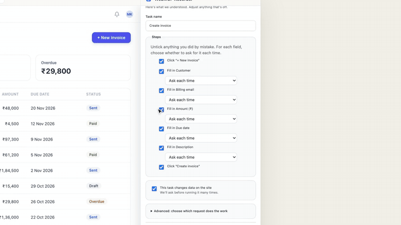
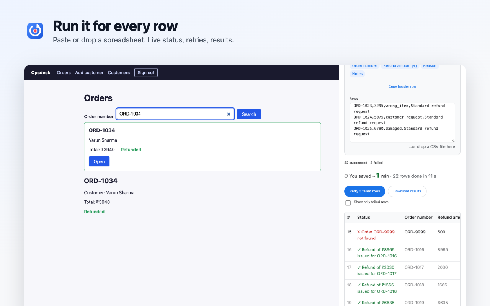
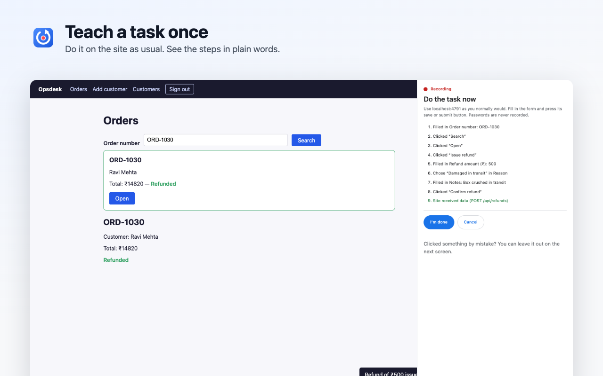
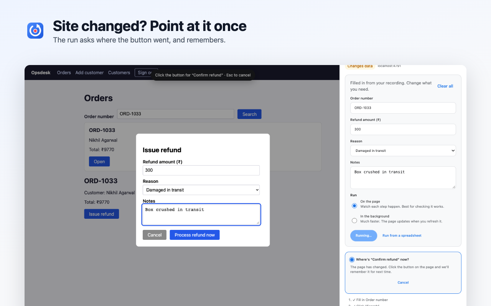

<p align="center">
  
</p>

<h1 align="center">WebMCP Recorder</h1>

<p align="center">
  teach a web task once, run it for every row of a spreadsheet.<br>
  a 100% local chrome extension that also turns your tasks into <a href="https://webmachinelearning.github.io/webmcp/">WebMCP</a> tools for ai agents.
</p>

<p align="center">
  <a href="../../releases/latest">download</a> ·
  <a href="#install-1-minute">install</a> ·
  <a href="#how-it-works">how it works</a> ·
  <a href="PRIVACY.md">privacy</a>
</p>

<p align="center">
  <a href="assets/demo.mp4"></a>
  <br>
  <sub><a href="assets/demo.mp4">watch the full 50-second demo</a> · <a href="https://x.com/itskuldeeep/status/2109515395396972761">or on x</a></sub>
</p>

<p align="center">
  
</p>

## why

a lot of work is typing the same thing into the same web form: invoices into a portal, refunds in an admin panel, bookings, new customers. most of those sites have no api, and most automation tools want an account, a cloud, or a script.

webmcp recorder watches you do the task once, then does it again, with new values, as many times as you need. everything stays in your browser.

## what it does

- **teach once.** do the task on the site as usual. it notes the fields you fill (by their on-page labels) and the button you press, and shows the steps in plain words.
- **run it again.** on the page, where a ghost cursor fills the form so you can watch, or in the background, where the request is sent directly in a fraction of a second.
- **run it for a spreadsheet.** paste rows from excel or google sheets, or drop a csv. every row shows its status live; retry the failures, download the results, see how much time you saved.
- **point-to-fix.** when a site changes and a button moves, the run asks *"where's the save button now?"*. click it once and the task remembers.
- **honest results.** every run reports what the site itself said ("invoice inv-104 saved", "email is invalid"), never a silent "done".
- **share with your team.** export a site's tasks to a file; teammates import it.
- **works with ai agents.** saved tasks are registered as webmcp tools (`document.modelContext`), so in-browser agents can call them.

<p align="center">
  
  
</p>

## install (1 minute)

1. download `webmcp-recorder-1.0.0.zip` from the [latest release](../../releases/latest) and unzip it.
2. open `chrome://extensions` and turn on **developer mode** (top right).
3. click **load unpacked** and choose the unzipped folder.
4. pin it from the puzzle icon. press **alt+shift+r** (or click the icon) to open the side panel.

works in chrome, brave, edge and arc (any chromium browser, version 116+). webmcp tools need a chrome with webmcp enabled; everything else works without it.

## use it

1. open the site → **teach a new task** → do the task → **i'm done**.
2. check the steps. for each field choose *ask each time* or *always the same*. **save task**.
3. **run** with new values, or **spreadsheet** to run it for every row.

try it on the bundled demo apps: `node test/fixtures/opsdesk/server.js` (refunds and customers, http://localhost:4791, any email, password `demo`) or `node test/fixtures/vendordesk/server.js` (invoices, http://localhost:4790).

## how it works

```
src/
  shared/      pure logic, unit-tested: request values, task building, spreadsheet parsing, result summaries
  page/        runs in the page: notes requests and filled fields while recording, replays requests, registers webmcp tools
  content/     the extension side of the page: per-site storage, recording, on-page replay, ghost cursor, point-to-fix
  background/  toolbar icon → side panel, task-count badge
  sidepanel/   the ui: home, recording, review, run and spreadsheet screens (no framework)
```

- **understanding a task:** the request that carries the values you typed becomes the task's fast path; the fields you filled become its inputs; everything else stays as recorded.
- **sign-ins are never stored:** passwords aren't recorded, and auth headers, cookies and csrf tokens are left out of saved tasks. runs reuse the session you're already signed in with.
- **reliable replays:** fields are filled the way typing does (react/angular/vue notice), runs continue across page loads, browser-blocked and server-rejected submits are reported with their reason, and a run in progress never leaks into other tabs.
- **fast:** no measurable page-load cost; spreadsheets run at ~0.3 s/row in the background and ~1.1 s/row on the page.

## privacy

no server, no account, no analytics. tasks live in `chrome.storage.local` on your machine, and requests only go to the site you're automating. full policy: [PRIVACY.md](PRIVACY.md).

## development

```bash
npm install
npm run build        # bundles src/ into dist/ (load dist/ unpacked)
npm run watch        # rebuild on change
npm test             # unit tests
npm run test:e2e     # drives the real extension in chromium: demo apps + live wikipedia, toolshop, b&b
npm run package      # release/webmcp-recorder-<version>.zip
```

limits: one site per recording (no cross-site flows), desktop chromium only, captcha / one-time codes / payments stay manual, forms inside iframes aren't recorded yet.

## license

[MIT](LICENSE)
